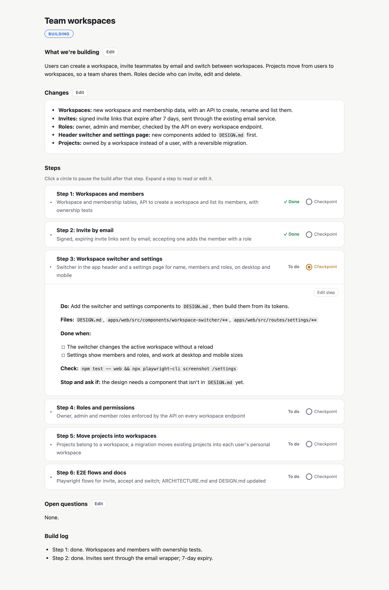

# SaaS Playbook

**Rules, workflows and skills that take a SaaS app through its lifecycle with an AI coding agent: from first idea to production today, with billing, growth, support and sunset planned ([coverage](#lifecycle-coverage)).**

Install it into a repo and your agent (Claude Code, Cursor, Codex, or anything that reads `AGENTS.md`) explores the idea first, plans before it builds, tests every step, checks security before every PR, and deploys to your cloud only when you say so.

```bash
npx github:subhash-arabhi/saas-playbook
```

## Highlights

- **One setup for Cursor, Claude Code, Codex and Copilot.** All four read the same `AGENTS.md`, rules and skills. How each finds skills and runs commands differs a little; see [Agent compatibility](#agent-compatibility).
- **Any cloud, a few fixed assumptions.** The agent picks the stack for each project within the cloud you name. The rules assume container images, infrastructure as code, a secret store read through workload identity, Tailwind, and Cloudflare in front of the custom domain at publish; see [What the rules assume](#what-the-rules-assume).
- **Six commands drive the whole lifecycle.** `/explore` → `/plan` → `/build` → `/push` → `/deploy` → `/publish`. The agent never pushes, deploys or publishes on its own.
- **Explore before you build.** Test the idea with a minimal local prototype, on the cheapest models, before any production work starts.
- **Plans you can read and edit.** Short plans with collapsible steps in a plan view inside Cursor or VS Code. Click a step's circle to make the build pause there, edit inline, then approve. A checker enforces the format.
- **A quality gate before every PR.** Simplification, full tests, Playwright E2E, Gitleaks, Semgrep, OSV-Scanner, a UI audit, a code review, a security review, and an LLM red-team when AI code changed. It runs in about 5–10 minutes.
- **Consistent design.** One `DESIGN.md` (tokens and every component) feeds the Tailwind theme. Every UI change is checked on desktop and mobile.
- **Deploys on your command.** Through your cloud's own CLI: infrastructure as code, one resource group per app, a budget cap with alerts at 50% and 75%, a smoke check and rollback on every deploy.
- **Private by default.** Secrets, cloud account and resource names and URLs live only in `.env.local`, and docs refer to them by key, so the repo is safe to make public.
- **AI features done right.** Models are researched and lightly tested per task, outputs are validated, and calls have timeouts, retries in one place and per-user cost caps.
- **Light on context.** About 2,300 tokens are loaded on every request. Rules hold the decisions; skills load only for the work at hand, and their detail sits in references read on demand.

## How it works

```text
 /explore ──► /plan ──► /build ──► /push ──────────► /deploy ──────────► /publish
 prototype    plan in    step by    pre-PR check,     merge, deploy,     legal, consent,
 locally,     plans/,    step, one  push, PR with     smoke check,       accessibility,
 decide       you        commit     before/after      rollback on        domain and
              approve    each       screenshots       failure            Cloudflare
```

| Command | What happens |
|---|---|
| `/explore <idea>` | Minimal local prototype to find out if the idea is worth building. Findings go in `EXPLORE.md` |
| `/plan [what]` | Writes a plan in `plans/` and asks everything up front: a dry run lists every question, including each risky action to approve, and repeats until none are left. After exploring, it first records the decision and switches to the build phase |
| `/build [plan]` | Builds an approved plan to the end, with tests and one commit per step. It decides and logs what the plan didn't cover, and stops only for checkpoints, unapproved risky actions or a check it can't fix. Run again to resume |
| `/push` | Your sign-off: runs the pre-PR check, pushes and opens the PR |
| `/deploy` | Merges the PR and deploys to production, then smoke-checks it |
| `/publish` | Readiness for real users (rare): legal pages, consent, privacy, accessibility, licenses, domain |

**`/flow-document [journey]`** works at any point: it writes or updates the product's flow document in `docs/flow/`, a page showing the user's journey as a tree, each step with how it works, its input and output, and its time and cost. A finished `/build` updates it when the plan changed a journey.

Typing the plain word ("push") works too. Large work outside a plan gets a suggestion to run `/plan`, and the agent asks when it's unsure. Questions come as multiple-choice cards in the agent's own question interface (Cursor, Claude Code, Codex, VS Code), with a recommended option first, not as text in the chat.

**CI is your choice.** The first `/push` asks whether the automated checks should also run in GitHub Actions on every PR, or stay local only. "Turn CI on" or "turn CI off" changes it later. CI only checks; deploys always run from your machine on `/deploy`.

### The plan view

Plans are plain markdown in `plans/`, shown as an editable view in Cursor and VS Code, or in the browser from any tool. The plan view opens by itself whenever the agent writes or changes a plan, stops at a checkpoint, or finishes a build (in Cursor, beside the chat), and an open view refreshes as the plan changes. A hook that the installer adds for Cursor and Claude Code makes this automatic; `node .agents/tools/plan.mjs open plans/<name>.md` does the same by hand. Expand a step to read or edit it, click a circle to make the build pause after that step, and approve when there are no open questions.

<picture>
  <source media="(prefers-color-scheme: dark)" srcset="docs/plan-view-dark.png">
  
</picture>

## Lifecycle coverage

| Stage | Status | What covers it |
|---|---|---|
| Discovery | Covered | `/explore`: a minimal local prototype on the cheapest models; findings and the decision go in `EXPLORE.md` ([`workflows/explore.md`](workflows/explore.md)) |
| Build | Covered | `/plan` and `/build`: approved plans, one tested commit per step, rules for each area and 13 skills ([`workflows/build-plan.md`](workflows/build-plan.md), [`rules/`](rules/)) |
| Release | Covered | `/push` runs the pre-PR check and opens the PR; `/deploy` deploys the reviewed commit with a smoke check and rollback; `/publish` covers legal pages, consent, accessibility and the domain ([`workflows/`](workflows/)) |
| Operations | Covered | Logs, metrics and alerts with a runbook entry each, a budget cap with alerts, backups that count only once a restore is tested ([`rules/deployment.md`](rules/deployment.md), [`rules/system-design.md`](rules/system-design.md)). Incident response is planned |
| Billing | Planned | Today only a rule: the agent asks before any payments change |
| Growth | Planned | Today analytics only appear as personal data: recorded in `ARCHITECTURE.md` and covered by consent at publish |
| Support | Planned | Nothing yet |
| Sunset | Planned | Today account deletion and data export are checked at publish |

Planned stages come in follow-up releases; see [`CHANGELOG.md`](CHANGELOG.md).

## Agent compatibility

The playbook is tested in Cursor. For the other agents, each entry was checked against the agent's documentation on 2026-10-15.

| | Cursor | Claude Code | Codex | Copilot (VS Code) |
|---|---|---|---|---|
| Reads `AGENTS.md` | Yes (tested) | Through `CLAUDE.md` → `@AGENTS.md`, which the installer adds (docs) | Yes (docs) | Yes (docs) |
| Finds the skills | `.agents/skills/` (tested) | `.claude/skills/`, which the installer links to `.agents/skills/` (docs) | `.agents/skills/` (docs) | `.agents/skills/` (docs) |
| Command skills run only when asked | Yes, `disable-model-invocation` (docs) | Yes, `disable-model-invocation` (docs) | **No**: Codex ignores `disable-model-invocation`, so only `AGENTS.md`'s "never run unasked" rule holds it back (docs) | Yes, `disable-model-invocation` (docs) |
| Slash commands | `/push` (tested) | `/push` (docs) | `$push` or the `/skills` menu; the plain word works too (docs) | `/push` (docs) |
| Plan view opens by itself | Yes, through the installed hook (tested) | Through the installed hook (docs; the hook's output has unit tests) | No hook; run `plan.mjs open` | No hook; run `plan.mjs open` |
| Compacts at about 500k tokens | **No**: Cursor fixes the point near the model's limit and it can't be set; type `/summarize` to compact sooner (docs, 2026-10-17) | Yes, `autoCompactWindow` in `.claude/settings.json` (docs, 2026-10-17) | Yes, `model_auto_compact_token_limit` in `.codex/config.toml`, once you trust the project (docs, 2026-10-17) | Yes, an advanced setting in `.vscode/settings.json` that VS Code's settings reference doesn't list (source code, 2026-10-17) |

| No AI attribution in commits and PRs | **Per user only**: turn off Cursor Settings → Git & PRs → Attribution, and `attribution` in `~/.cursor/cli-config.json` for the CLI; until then the commit-msg hook strips the commit trailer and `/push` removes the PR footer (docs, 2026-10-20) | Yes, `attribution` in `.claude/settings.json` (docs, 2026-10-20) | Yes, `commit_attribution = ""` in `.codex/config.toml`, once you trust the project (docs, 2026-10-20) | Yes, `git.addAICoAuthor` in `.vscode/settings.json` (docs, 2026-10-20) |

Compaction summarises older history so a long session keeps going. Models with windows under 500k tokens compact earlier, at each tool's own point.

## Install

### The full playbook (recommended)

Run in the root of your project (Node 18+, git and bash):

```bash
npx github:subhash-arabhi/saas-playbook
```

Or from a clone: `./install.sh /path/to/project`.

It adds:

| Path | What it is | Committed |
|---|---|---|
| `AGENTS.md` | The mandatory rules, commands and areas table. Fill in its "Project-specific" section | Yes |
| `CLAUDE.md` | One line, `@AGENTS.md`, so Claude Code reads it | Yes |
| `.claude/skills` → `.agents/skills` | Link for Claude Code's skill discovery | Yes |
| `.cursor/hooks.json`, `.claude/settings.json` | A hook that shows a plan in the plan view whenever the agent changes it. Added to existing files, keeping your settings | Yes |
| `.claude/settings.json`, `.codex/config.toml`, `.vscode/settings.json` | Compact agent sessions at about 500k tokens ([compatibility](#agent-compatibility)). A value you already set is kept; a file with comments is left alone, with the line to add | Yes |
| `.claude/settings.json`, `.codex/config.toml`, `.vscode/settings.json` | Turn off each tool's "Co-authored-by" trailer and "Generated with" PR line. A value you already set is kept | Yes |
| `.git/hooks/commit-msg` | Strips AI-tool attribution from every commit, whichever tool made it, and keeps human co-authors. An existing hook is left alone, with the line to add | No (git hooks aren't cloned; `AGENTS.md` has the agent reinstall it) |
| `.agents/playbook.json` | The installed version, its reinstall command, the playbook's skill list, and every file it installed with its SHA-256 | Yes |
| `.agents/.gitignore` | Keeps the playbook's own files out of git | Yes |
| `.agents/` rules, workflows, reviewers, references, templates, tools and skills | The playbook itself | **No**, reinstalled from `playbook.json` |
| `.agents/skills/<your-skill>/` | Your project's own skills, side by side with the playbook's | Yes |
| `plans/` | Where plans go | Yes |

Later, if you choose CI on the first `/push`, the agent adds `.github/workflows/pre-pr.yml` from `.agents/templates/ci.yml`: pinned actions, read-only access, no secrets. It can also make the check required on `main`, only if you say yes.

Commit, then start a session with: *"Read AGENTS.md and follow it strictly."*

**Your skills and the playbook's stay separate.** The playbook's skills are listed in `.agents/playbook.json` and gitignored; every other folder in `.agents/skills/` is yours, committed with the project and never touched by updates. Name your skills in `AGENTS.md` → Project-specific.

**Fresh clones set themselves up, with your OK.** When `.agents/rules/` is missing, `AGENTS.md` tells the agent to show the pinned install command from `playbook.json` and ask before running it, so teammates and cloud agents get exactly the same version. To keep the playbook in git instead, install with `--commit` (the choice is remembered).

**Each version is pinned to its content.** `playbook.json` records a checksum of everything the installer copied. Reinstalling the same version with different content (a moved tag, or a changed download) stops with an explanation and changes nothing; `--force` installs it anyway.

**Update deliberately:** run `npx github:subhash-arabhi/saas-playbook#vX.Y.Z` with the release you want (or without `#vX.Y.Z` for the latest), review the changes, and commit `playbook.json` so everyone gets the same version and checksum. It replaces the playbook's files, removes skills the playbook dropped, keeps yours, and never overwrites your `AGENTS.md`; if the playbook's `AGENTS.md` changed, it writes `AGENTS.playbook.md` for you to merge.

**Updates only touch what the playbook installed.** It deletes only the files listed in `playbook.json`. A file you edited is copied to `.agents/.backup/<timestamp>/` before it's replaced, so you can carry the change over (better: put it in a project skill or `AGENTS.md` → Project-specific). The install stops, changing nothing, if `.agents/` already has playbook folders but no `playbook.json`, or if one of your skills has the same name as a playbook skill. Rename or move them, or run with `--force` to back them up and install over them.

**Plan view in Cursor or VS Code** (optional): `bash .agents/tools/plan-editor/install.sh`, then open any `plans/*.md`. Elsewhere, `node .agents/tools/plan.mjs view` serves it at http://localhost:4600.

### Single skills

The general skills also work on their own, in any project:

```bash
npx skills add subhash-arabhi/saas-playbook
npx skills add subhash-arabhi/saas-playbook --skill security-and-hardening
```

Each skill follows the playbook's rules when `.agents/rules/` exists, and stands on its own when it doesn't. The command skills come only with the full playbook.

## Skills

| Skill | What it does |
|---|---|
| `incremental-implementation` | Builds in thin, tested, committed steps |
| `api-and-interface-design` | Stable APIs: contracts, errors, pagination, additive changes, idempotency |
| `frontend-ui-engineering` | Production UI from the design system, every state, desktop and mobile, no "AI look" |
| `design-motion-principles` | Purposeful motion: CSS first, Motion (formerly Framer Motion) when needed, restrained in apps, expressive on marketing pages |
| `browser-testing-with-devtools` | Checks pages in a real browser: console, network, layout, performance |
| `playwright-cli` | Browser automation and Playwright tests (vendored from Microsoft) |
| `security-and-hardening` | OWASP Top 10 and LLM Top 10, secrets, auth, uploads, supply chain |
| `observability-and-instrumentation` | Structured logs, metrics, traces and alerts that answer real questions |
| `debugging-and-error-recovery` | Root-cause debugging, starting from a failing test |
| `code-review-and-quality` | Five-axis review: correctness, readability, architecture, security, performance |
| `code-simplification` | Simpler code with the same behaviour |
| `web-design-guidelines` | UI audit against interface guidelines and design tokens |
| `flow-document` | The product's user journey as a clickable tree, each step with how it works, input, output, time and cost (`/flow-document`) |

## What's inside

| Folder | Contents |
|---|---|
| `templates/project-AGENTS.md` | The project's `AGENTS.md`: phase, the Always rules, commands, and which rules and skills each area needs |
| `rules/` | The decisions: planning, stack, system design, AI, repo structure, backend, frontend, database, testing, security, documentation, git, deployment |
| `workflows/` | Exactly what happens on explore, build, push (with the pre-PR check), deploy and publish |
| `skills/` | The 13 skills above, plus the six command skills |
| `reviewers/` | Code reviewer, security auditor, test engineer |
| `references/` | Security, accessibility and publish checklists; reference design systems |
| `templates/` | `plan.md`, `ARCHITECTURE.md`, `DESIGN.md`, PR description, the flow document page, and the project's `AGENTS.md` |
| `tools/` | Plan checker and viewer (`plan.mjs`), the plan hooks, and the plan editor extension |
| `AGENTS.md`, `tests/` | For working on the playbook itself: maintainer instructions and its test suite |

The agent creates the per-project files as it goes: `ARCHITECTURE.md`, `DESIGN.md`, `infra/`, `scripts/pre-pr.sh` and `docker-compose.yml`.

## Customising

- **Project rules** go in the "Project-specific" section of the project's `AGENTS.md`. They override the playbook's rules.
- **Project-only skills** go in `.agents/skills/<name>/`, under a name the playbook doesn't use. Updates keep them.
- **Don't edit the playbook inside `.agents/`;** change the source and re-install.
- **If the agent skips a step,** name it: "You skipped step 4 of push.md. Redo it." Exact references work better than general reminders.

## Requirements

- An agent that reads `AGENTS.md` and Agent Skills ([compatibility](#agent-compatibility))
- Node 18+, git and bash
- Docker, for the local database
- Your cloud's CLI, already logged in, when you deploy

### What the rules assume

The stack is chosen per project, but the rules expect the cloud to provide:

- **Container images** in the cloud's registry, tagged with the commit SHA, so a deploy or rollback switches the apps to another tag ([`rules/deployment.md`](rules/deployment.md))
- **Infrastructure as code** in `infra/`, one resource group per app with a budget cap, deployed from your machine with the cloud's CLI (deploys never run from CI)
- **A secret store** that the app reads through the cloud's managed (workload) identity, with no keys in settings or images
- **Tailwind CSS** for styling, fed by `DESIGN.md` ([`rules/frontend.md`](rules/frontend.md))
- **Cloudflare** in front of the custom domain, set up at `/publish`; before that the app uses the cloud's own URL ([`rules/stack.md`](rules/stack.md))

## Credits

Several skills, reviewers and checklists are adapted from excellent open-source work: [addyosmani/agent-skills](https://github.com/addyosmani/agent-skills), [microsoft/playwright-cli](https://github.com/microsoft/playwright-cli), [vercel-labs/web-interface-guidelines](https://github.com/vercel-labs/web-interface-guidelines), [kylezantos/design-motion-principles](https://github.com/kylezantos/design-motion-principles), [Leonxlnx/taste-skill](https://github.com/Leonxlnx/taste-skill) and [VoltAgent/awesome-design-md](https://github.com/VoltAgent/awesome-design-md). The `DESIGN.md` format is from [google-labs-code/design.md](https://github.com/google-labs-code/design.md). Pinned commits and changes are listed in [`licenses/README.md`](licenses/README.md).

## License

[MIT](LICENSE). Third-party content keeps its own license (MIT, or Apache-2.0 for `playwright-cli`); the license files are in [`licenses/`](licenses/).
