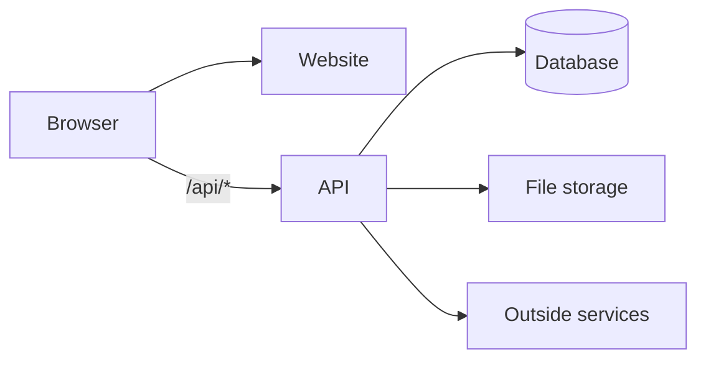

# Architecture: <Project name>

<!--
  Read this first. It is the full picture of the system for any new agent or developer.
  Update it in EVERY PR (see .agents/rules/documentation.md). Bump "Last updated" even if nothing else changed.

  NEVER put secrets here: no API keys, passwords, tokens, connection strings with credentials,
  SAS URLs, or webhook URLs that contain tokens. Name WHERE a secret lives (e.g. the secret store's secret name), never its value.

  NEVER put other private values here either: cloud account, resource group and resource names, cloud IDs,
  URLs and endpoints, portal links, personal details. They live only in .env.local.
  Refer to them by key, e.g. `.env.local` → `PUBLIC_URL` (see .agents/rules/documentation.md → Private values).
-->

**Last updated:** <YYYY-MM-DD>, <plan file or PR title>

## What it is
<2–3 plain sentences: what the product does and for whom.>

**Scale assumptions:** <users, requests/day, data size: start small> · **Not doing:** <deliberate non-goals>

## System diagram

## Components
| Component | What it does | Why it exists (and when to remove or split it) | Tech | Hosted on | Code |
|---|---|---|---|---|---|
| Website | | | | <cloud service> | `path/` |
| API | | | | <cloud service> | `path/` |
| Database | | | | <cloud service> | migrations in `path/` |
| File storage | | | | <cloud service> | |
| Background jobs | | | | | |

## Module map
| Module | Public interface | Tables it owns |
|---|---|---|
| | | |

## Project structure
<Where things live: app code (organised by feature), shared code, tests, E2E tests, migrations, generated code (e.g. the OpenAPI client), `infra/`, `scripts/`, `plans/`.>

## Environments and URLs
| | Local | Production (`.env.local` key) |
|---|---|---|
| Public URL (website + `/api`) | `http://localhost:<port>` | `PUBLIC_URL` |
| Cloud app URL(s), direct | n/a | `<KEY>` |
| API health | `/api/health` | `PUBLIC_URL` + `/api/health` |
| API docs / contract | | |

There's no staging: changes go from local straight to production on "deploy".

## Cloud resources
**Cloud:** <provider> · **Account:** `CLOUD_ACCOUNT` · **Resource group:** `CLOUD_RESOURCE_GROUP` · **Region:** <region> (keys in `.env.local`)

<!-- Types, tiers and regions only. Names, URLs and IDs go in .env.local; list their keys here. -->
| Resource (type, tier) | Name key | Region | URL / endpoint key | Notes |
|---|---|---|---|---|
| | | | | |

## AI models
| Task | Config name | Model | Why (candidates tried) | ~Cost per call |
|---|---|---|---|---|
| | | | | |

## Outside services
| Service | Used for | Called from | Timeout / retries | Fallback | Cost cap | Endpoint key (`.env.local`) | Secret lives in (name only) |
|---|---|---|---|---|---|---|---|
| | | | | | | `<KEY>` | Secret store: `<secret-name>` |

## Auth
<How users sign in, where sessions/tokens live, cookie domain, how ownership (`owner_id`) is enforced.>

## Data model
<Main tables/collections and how they relate. One line each.>

## Personal data
Every piece of personal data the app stores, sends to an outside service or collects through analytics. Add the row in the step that adds the data.

| Data | Purpose | Retention | Deletion | Shared with |
|---|---|---|---|---|
| <e.g. email> | <sign-in, receipts> | <until the account is deleted> | <account deletion removes it from the database and, within N days, backups> | <none, or the service and why> |

## Key flows
<2–3 sequence diagrams (mermaid `sequenceDiagram`): e.g. sign-in, the core create action, an async job (202 → poll → result). They match the Playwright E2E flows.>

## Failure modes
| What breaks | What the user sees | Mitigation |
|---|---|---|
| | | |

## Configuration
Every setting and private-value key is listed in `.env.example`. Real values (secrets and other private values) are only in `.env.local` (gitignored). Deployed secrets come from the cloud's secret store via managed identity.

## How to run and test
- Run locally: see `README.md`.
- Tests: <command>. E2E: <command>.
- Push and PR: say "push" (`.agents/workflows/push.md`). Deploy: say "deploy" (`.agents/workflows/deploy.md`).

## Deploy
- **How:** from the agent's machine with the cloud's CLI: `infra/deploy.sh` (say "deploy", `.agents/workflows/deploy.md`).
- **Account / resource group:** `CLOUD_ACCOUNT` / `CLOUD_RESOURCE_GROUP` (`.env.local`)
- **Order:** migrations → API → website
- **Images:** tagged with the git commit SHA, in the registry `<KEY>` (`.env.local`)
- **Rollback:** point apps at the previous tag or revision
- **Smoke check:** `PUBLIC_URL` + `/api/health`, homepage, website → API

## Monitoring and alerts
- **Monitoring resource:** <service>, name in `.env.local` → `<KEY>` (API + website telemetry). Daily cap: <GB>.
- **Availability tests:** `/api/health` and the homepage, on `PUBLIC_URL`.
- **Alert delivery:** email to `.env.local` → `ALERT_EMAIL`; the cloud's mobile app push for "notify me now".

<!-- One entry per alert. Keep each short: what it means, first check, fix or rollback. -->
### Alert: <name>
**Severity:** notify me now | show me later
**Means:** <likely causes>
**First check:** <where to look first>
**Fix:** <what to do, or "roll back (.agents/workflows/deploy.md)">

## Cost estimate
| Component | Tier | ~Monthly cost |
|---|---|---|
| | | |

**Budget cap:** <amount> per month on the resource group (set by the user), alerts at 50% and 75%.

## Known gaps and decisions
- <Notable decision, and why, or link to the plan where it was made.>
- <Known limitation or debt.>
